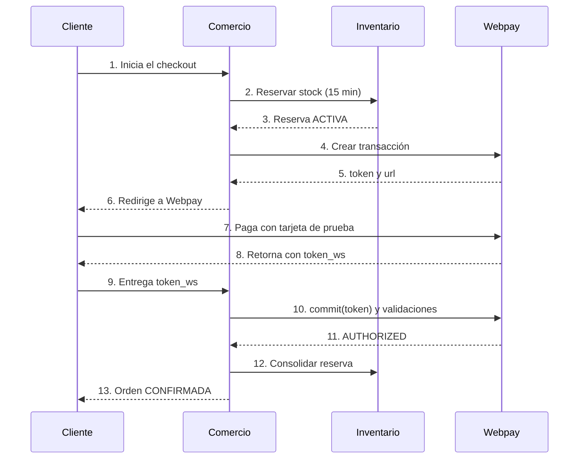

# Compra con Webpay Plus

> Diseño propuesto (reserva de 15 minutos). Pendiente confirmar plazos de Webpay.

## Camino feliz

| Paso | Origen | Destino | Acción |
|-----:|--------|---------|--------|
| 1 | Cliente | Comercio | Inicia el checkout |
| 2 | Comercio | Inventario | Reservar stock (todo o nada, 15 min) |
| 3 | Inventario | Comercio | Reserva ACTIVA |
| 4 | Comercio | Webpay | Crear transacción (fuera de la transacción de MongoDB) |
| 5 | Webpay | Comercio | Devuelve token y url |
| 6 | Comercio | Cliente | Redirige a Webpay |
| 7 | Cliente | Webpay | Paga con tarjeta de prueba |
| 8 | Webpay | Cliente | Retorna con `token_ws` |
| 9 | Cliente | Comercio | Entrega `token_ws` |
| 10 | Comercio | Webpay | `commit(token)` y validar `estado`, `response_code`, `monto` y `buy_order` |
| 11 | Webpay | Comercio | AUTHORIZED |
| 12 | Comercio | Inventario | Consolidar reserva (baja stock físico y reservado) |
| 13 | Comercio | Cliente | Orden CONFIRMADA |

## Caminos alternativos y errores

Casos que el backend debe manejar. Los estados son los mínimos del enunciado.

| Situación | Qué llega | Qué hace Comercio |
|-----------|-----------|-------------------|
| Cliente cancela en Webpay | `TBK_TOKEN` en vez de `token_ws` | Liberar reserva (LIBERADA); orden CANCELADA |
| Pago rechazado | `commit` con estado distinto de AUTHORIZED | Liberar reserva; orden RECHAZADA |
| Cliente no vuelve | Nada | A los 15 min consultar status; si es INITIALIZED, liberar (VENCIDA) |
| Retorno repetido | `token_ws` de una orden ya confirmada | No repetir `commit` ni consolidar; devolver el resultado guardado |
| `commit` aprobado pero falla Inventario | AUTHORIZED sin consolidación | Orden CONFIRMACION_PENDIENTE y conciliación (reintentable sin duplicar movimientos) |
